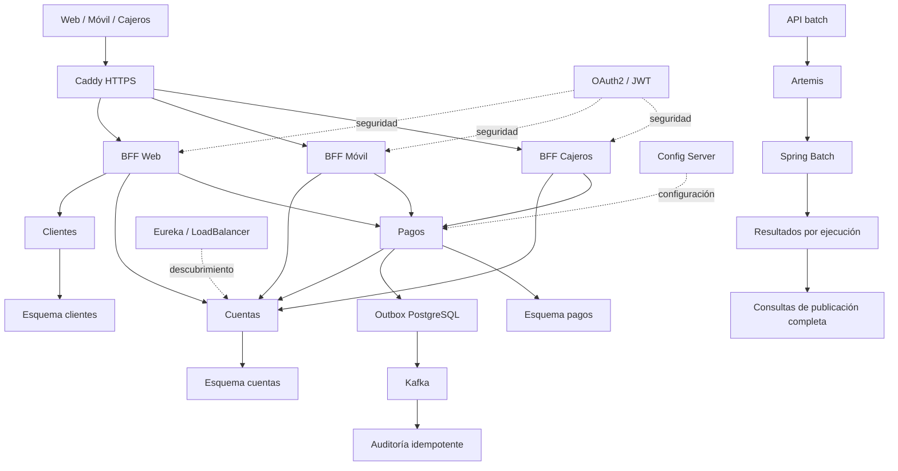
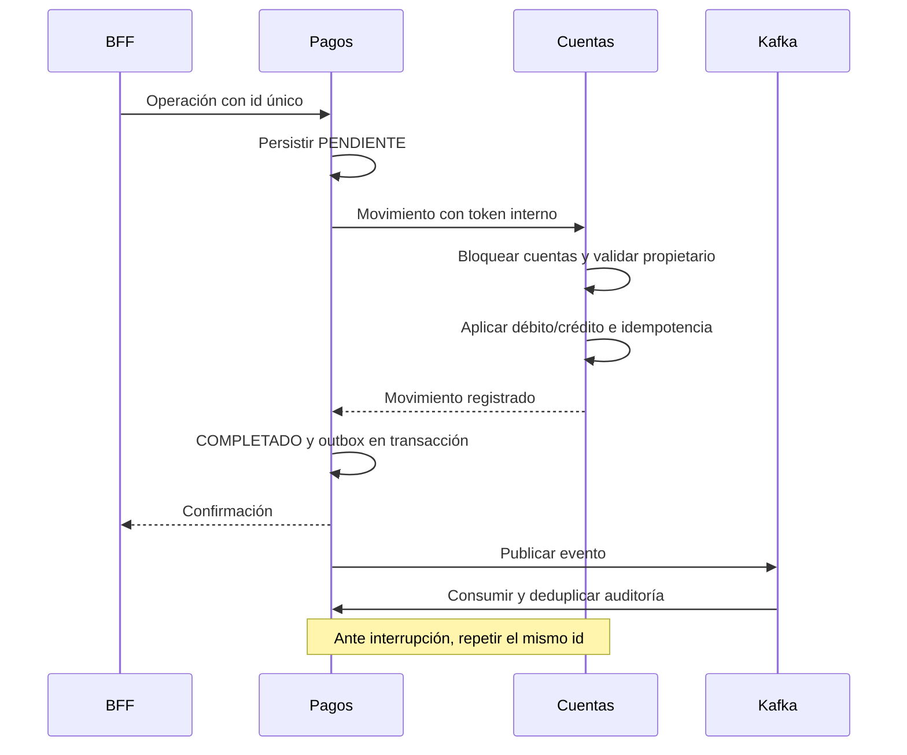

# Arquitectura del Banco XYZ

La [justificación de infraestructura AWS](justificacion-infraestructura.md) describe dimensionamiento, seguridad, costos y límites del despliegue.

## Requisitos y decisiones

| Requisito del negocio | Decisión | Justificación |
|---|---|---|
| Integridad monetaria | Cuentas posee saldos y registra ambos lados de una transferencia en una transacción | Impide débitos sin crédito y sobregiros concurrentes |
| Continuidad operativa | Pagos pendientes persistentes, circuitos y outbox | Permite recuperar llamadas y publicar eventos tras una caída |
| Canales eficientes y protegidos | Tres BFF, scopes y canal firmado | Reduce datos móviles y restringe operaciones de cajeros |

## Componentes

La separación de esquemas mantiene propiedad lógica de datos dentro de una instancia PostgreSQL. No equivale a bases físicamente independientes ni a aislamiento por credenciales. Cada servicio accede a su esquema; la evolución a bases y usuarios separados requiere configurar fuentes y migraciones.

## Pago y recuperación

El saldo tiene consistencia transaccional dentro de cuentas. El estado de pagos y la auditoría son eventualmente consistentes. Una llamada con respuesta perdida puede haber aplicado el movimiento; mantener PENDIENTE y repetir el identificador permite reconocerlo sin duplicarlo.

## Casos de uso

El canal web consulta perfil, abre y mantiene cuentas, cierra cuentas sin saldo y realiza operaciones. El canal móvil consulta un resumen reducido y realiza pagos. El cajero consulta saldo y retira fondos. Un operador solicita reportes diarios, intereses mensuales y estados anuales. El administrador crea perfiles y consulta auditoría desde las APIs internas autorizadas.

## Procesos de migración

Los cinco ejes son reescritura batch, separación del dominio en microservicios, BFF por canal, seguridad distribuida y eventos Kafka. La mensajería Artemis conserva el control batch existente; Kafka implementa los eventos bancarios requeridos. Config Server y Eureka se reutilizan y se amplían con los nuevos módulos.

## Reglas y límites

Moneda única CLP, importes positivos con hasta dos decimales, débitos solo sobre cuentas propias activas y cierre con saldo cero. Los depósitos son simulados. Las tasas y límites de edad del batch son supuestos de referencia. Los datos conservan registros con identificadores distintos aunque coincidan otros campos; la repetición de un identificador de transacción se rechaza por la clave de ejecución e id.

El despliegue se prepara para AWS con Compose y HTTPS. La demostración usa identidades OAuth2 de aplicaciones y perfiles fijos; la autenticación de personas requiere un proveedor de identidad. El entorno no implementa alta disponibilidad entre hosts ni TLS interno.
